

<a href="https://portfolioweb-71c1.vercel.app/">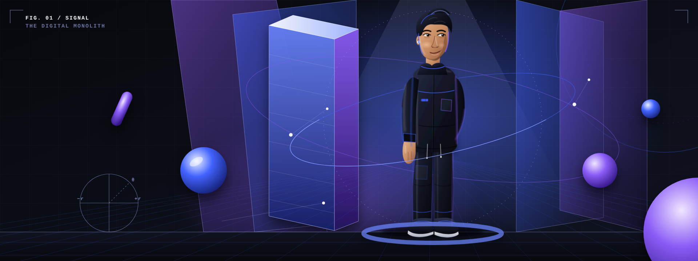</a>

# AZFAR MOIN

**SOFTWARE ENGINEERING × CREATIVE DEVELOPMENT**

> “Engineering useful things. Exploring extraordinary interfaces.”

`KHI / PK` · `FULL-STACK SYSTEMS` · `INTERFACE EXPERIMENTS` · `BUILDING IN PUBLIC`

**[IDENTITY ↓](#02--identity)** · **[STACK ↓](#03--architecture)** · **[PROJECTS ↓](#04--experiments)** · **[GITHUB ↗](https://github.com/Azfarmoin)** · **[LINKEDIN ↗](https://www.linkedin.com/in/azfar-moin-9bb31339b/)** · **[PORTFOLIO ↗](https://portfolioweb-71c1.vercel.app/)**

 

<a href="models/monolith.stl"></a>

**[OPEN THE REAL 3D MODEL ↗](models/monolith.stl)** · GitHub renders `.stl` files as an interactive viewer: drag to rotate, scroll to zoom.

The spinning preview is a pre-rendered SVG loop. GitHub READMEs can't run Three.js, so the interactive version lives in the viewer.

 

---

## 02 — IDENTITY

<table>
<tr>
<td width="34%" valign="top">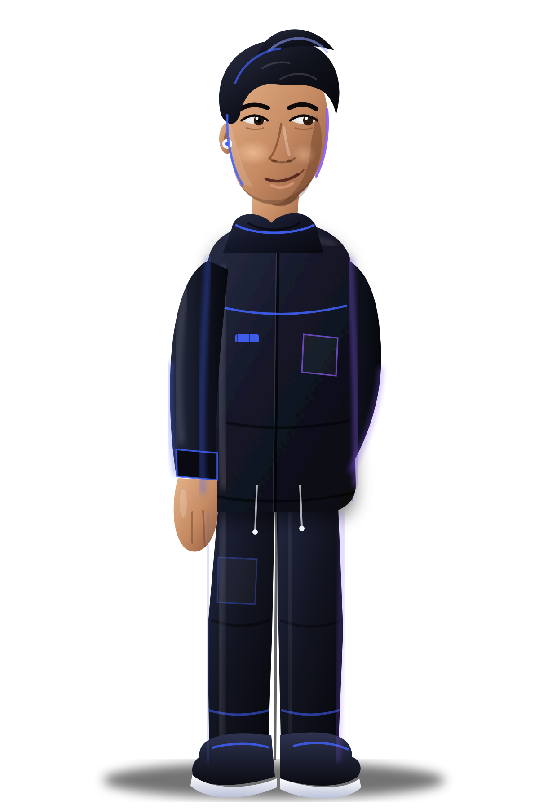</td>
<td valign="top">

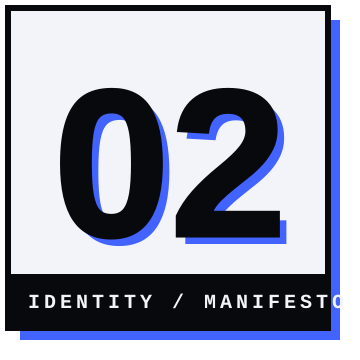

### “I build where engineering meets interaction.”

I'm a Software Engineering undergraduate exploring full-stack web development, application architecture, and creative interfaces. I enjoy turning ideas into useful applications, understanding how systems work beneath the interface, and experimenting with technologies that make digital experiences more expressive.

I'm focused on strengthening my engineering fundamentals, building practical projects, and learning through implementation.

The character is an original fictional digital persona, not a likeness of me.

</td>
</tr>
</table>

---

## 03 — ARCHITECTURE

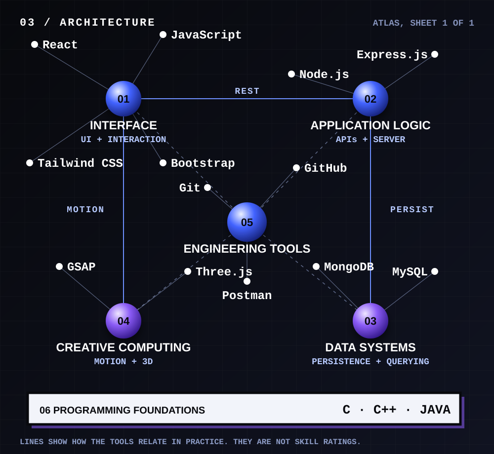

<code>TEXT INDEX</code> (same content, readable anywhere)

| № | Discipline | Tools |
|---|---|---|
| 01 | Interface | React · JavaScript · Tailwind CSS · Bootstrap |
| 02 | Application Logic | Node.js · Express.js |
| 03 | Data Systems | MongoDB · MySQL |
| 04 | Creative Computing | GSAP · Three.js |
| 05 | Engineering Tools | Git · GitHub · Postman |
| 06 | Programming Foundations | C · C++ · Java |

---

## 04 — EXPERIMENTS

`STATUS KEY` &nbsp; **DEPLOYED** = live link verified &nbsp;·&nbsp; **SOURCE** = code on GitHub, no live demo linked &nbsp;·&nbsp; **UNVERIFIED** = placeholder, details pending

 

<table>
<tr>
<td width="50%" valign="top">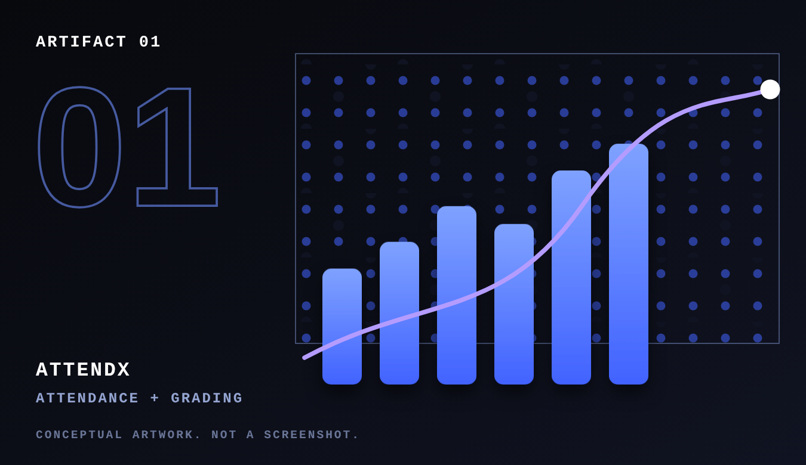</td>
<td width="50%" valign="top">

#### 01 · AttendX
`SOURCE` · MERN · v2.0

Student attendance and grading system with analytics and CSV exports.

- **Grading engine:** weighted assessments, an optional attendance penalty and configurable grade scales that roll up into GPA.
- **Hardened API:** JWT auth with admin and teacher roles, rate limiting, helmet, input sanitising.

`React` `Vite` `Tailwind` `Express` `MongoDB` `Mongoose` `JWT` `Recharts`

**[REPOSITORY ↗](https://github.com/Azfarmoin/attendancex)**

</td>
</tr>
</table>

<table>
<tr>
<td width="50%" valign="top">

#### 02 · Aura
`UNVERIFIED` · MERN e-commerce

Placeholder. I couldn't find a public repository named `Aura` on this profile, so no functionality is claimed yet.

**REPOSITORY LINK · PENDING**

</td>
<td width="50%" valign="top">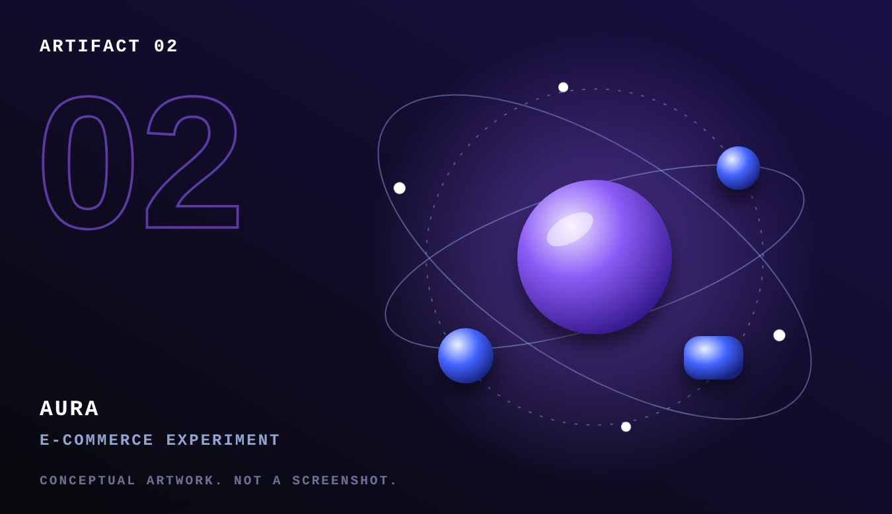</td>
</tr>
</table>

<table>
<tr>
<td width="50%" valign="top">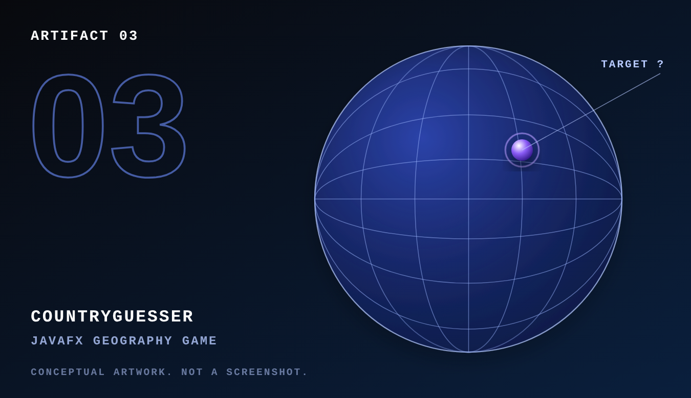</td>
<td width="50%" valign="top">

#### 03 · CountryGuesser
`UNVERIFIED` · JavaFX

Placeholder. A geography guessing game built with JavaFX. I couldn't find a public repository named `CountryGuesser` yet, so no features are claimed.

**REPOSITORY LINK · PENDING**

</td>
</tr>
</table>

<table>
<tr>
<td width="50%" valign="top">

#### 04 · Portfolio
`DEPLOYED` · Vercel

My developer site, the home of my work.

**[VISIT SITE ↗](https://portfolioweb-71c1.vercel.app/)**

</td>
<td width="50%" valign="top">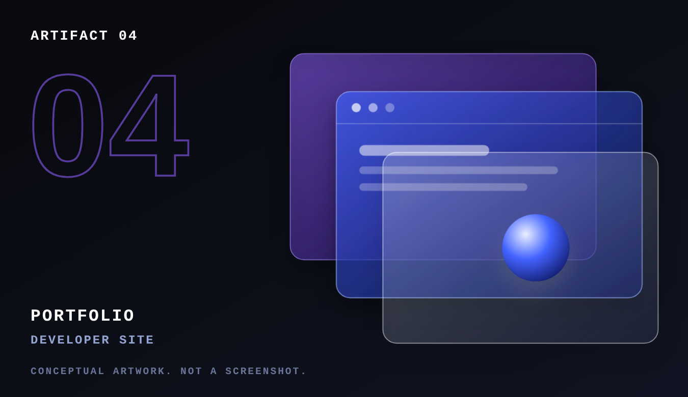</td>
</tr>
</table>

Project artwork is conceptual, not screenshots. Real screenshots will replace it as they're added.

**[ALL REPOSITORIES ↗](https://github.com/Azfarmoin?tab=repositories)**

---

## SYS.MONITOR


`LIVE` **[PROFILE ↗](https://github.com/Azfarmoin)** · **[REPOSITORIES ↗](https://github.com/Azfarmoin?tab=repositories)** · **[ATTENDX COMMITS ↗](https://github.com/Azfarmoin/attendancex/commits/main)**

---

## 05 — CONNECTION


### “Good ideas become better when they are built together.”

I'm interested in meaningful software projects, opportunities to learn from experienced engineers, and collaborations that turn practical ideas into useful products.

Explore the work. Start a conversation. Build something worthwhile.

**[GITHUB ↗](https://github.com/Azfarmoin)** &nbsp;·&nbsp; **[PORTFOLIO ↗](https://portfolioweb-71c1.vercel.app/)** &nbsp;·&nbsp; **[LINKEDIN ↗](https://www.linkedin.com/in/azfar-moin-9bb31339b/)**

`24.8607° N / 67.0011° E` · Karachi, Pakistan · a decorative coordinate, not a live location
